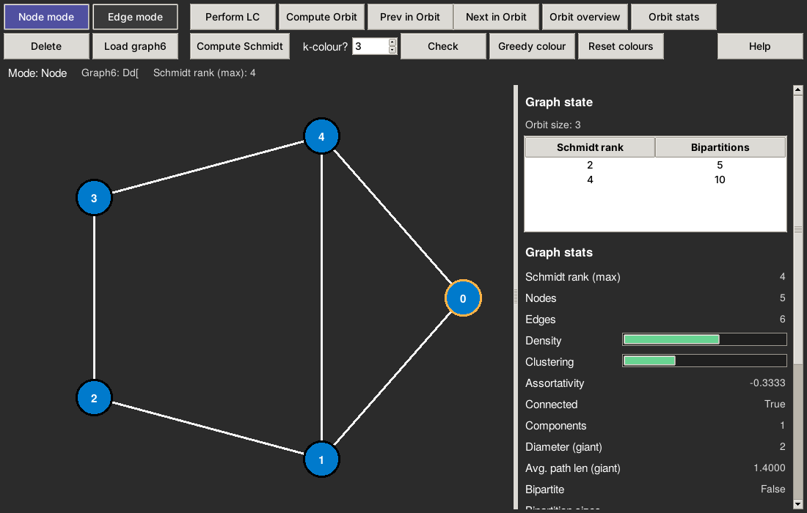
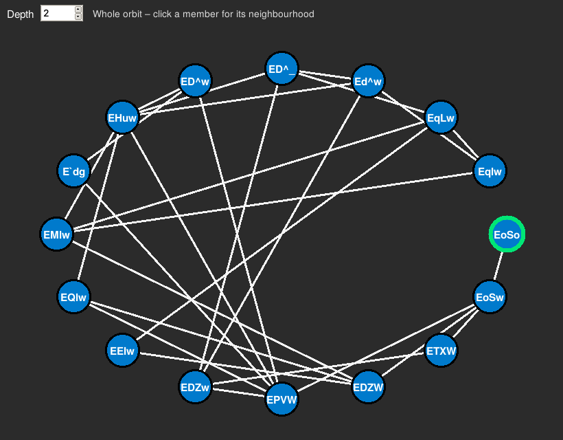

# Graph State Orbit Explorer

Graph State Orbit Explorer is a desktop application for studying graph states
under local complementation (LC). You draw a graph or load it as a graph6
string, apply LC at any vertex, and compute the complete LC orbit of the graph
up to isomorphism. The orbit can be browsed member by member, drawn as a graph
of graphs, and summarised in a table of invariants. For every graph the
application shows the Schmidt rank of the graph state across each bipartition
of its qubits, together with a set of standard graph invariants.

The application runs on **Linux**. It is written in Python with Tkinter, uses
NetworkX for graph algorithms and nauty (through pynauty) for canonical
labelling.



*Main window. The five-vertex ring after LC at vertex 0, which adds the edge
1–4. The panel on the right shows the orbit size and the Schmidt-rank
distribution over all 15 bipartitions, unchanged by the LC.*

## Contents

- [Features](#features)
- [Background](#background)
- [Installation](#installation)
- [Quick start](#quick-start)
- [Controls](#controls)
- [Statistics](#statistics)
- [Using the modules from Python](#using-the-modules-from-python)
- [Performance and limits](#performance-and-limits)
- [Standalone application](#standalone-application)
- [Tests](#tests)
- [Project layout](#project-layout)
- [Contributing and support](#contributing-and-support)
- [Citation](#citation)
- [License](#license)

## Features

- **Graph editor.** Add, move, rename and delete vertices and edges with the
  mouse, or load a graph from a graph6 string.
- **Local complementation.** Apply LC at a selected vertex. The graph is edited
  in place, so vertex labels and positions are kept.
- **LC orbits.** Compute every graph reachable by LC, up to isomorphism, and
  step through the orbit.
- **Orbit overview.** Draw the orbit as a graph whose vertices are orbit
  members and whose edges are single LC moves. Click a member to load it.
- **Entanglement.** Schmidt rank of the graph state across every bipartition,
  its distribution, and its maximum.
- **Invariants and export.** Connectivity, diameter, clustering, planarity,
  clique number, chromatic bounds, exact k-colourability and more; a table of
  invariants for every member of an orbit, exported as CSV.

## Background

**Graph states.** A simple graph G with vertex set V defines the n-qubit graph
state

    |G⟩ = ∏_{(a,b) ∈ E} CZ_ab |+⟩^⊗n ,

one qubit per vertex and one controlled-Z gate per edge.

**Local complementation.** LC at a vertex v replaces the subgraph induced on
the neighbourhood N(v) by its complement: two neighbours of v that are joined
become disjoint, and two that are disjoint become joined. On graph states, LC
is implemented by a local Clifford unitary. Two graph states are equivalent
under local Clifford operations if and only if their graphs are related by a
sequence of LCs [Van den Nest, Dehaene & De Moor 2004].

**Orbits.** The application identifies graphs up to isomorphism, using a
canonical graph6 string computed by nauty. An LC orbit is therefore the set of
isomorphism classes reachable by LC: the graph states that are equivalent
under local Clifford operations combined with a relabelling of the qubits.
For connected graphs on 2, 3, 4, 5, 6 and 7 vertices there are 1, 1, 2, 4, 11
and 26 orbits [Hein, Eisert & Briegel 2004]; the test suite reproduces these
numbers. Local-unitary equivalence is a coarser relation: there are graph
states that are equivalent under local unitaries but not under local Clifford
operations [Ji, Chen, Wei & Ying 2010]. The orbits computed here are LC
classes.

**Schmidt rank.** For a bipartition A|B of the qubits, let Γ_AB be the
adjacency matrix between A and B and r(A) its rank over GF(2). The reduced
state of |G⟩ on A has 2^r(A) non-zero eigenvalues, all equal to 2^−r(A). The
Schmidt rank across A|B is therefore 2^r(A), and the entanglement entropy is
r(A) ebits [Hein, Eisert & Briegel 2004]. Schmidt ranks do not change under
local unitaries, so the distribution of Schmidt ranks over all 2^(n−1) − 1
bipartitions is the same for every member of an LC orbit. Its maximum is a
lower bound on the Schmidt measure of |G⟩.

**References**

- M. Hein, J. Eisert and H. J. Briegel, *Multiparty entanglement in graph
  states*, Phys. Rev. A **69**, 062311 (2004).
- M. Van den Nest, J. Dehaene and B. De Moor, *Graphical description of the
  action of local Clifford transformations on graph states*, Phys. Rev. A
  **69**, 022316 (2004).
- Z. Ji, J. Chen, Z. Wei and M. Ying, *The LU-LC conjecture is false*,
  Quantum Inf. Comput. **10**, 97 (2010).
- W. Helwig, W. Cui, J. I. Latorre, A. Riera and H.-K. Lo, *Absolute maximal
  entanglement and quantum secret sharing*, Phys. Rev. A **86**, 052335
  (2012).

## Installation

Requirements: Linux, Python 3.10 or newer with Tkinter, a C compiler and GNU
make. The application has been tested with Python 3.12.

pynauty provides a prebuilt package only for Python 3.12 on x86-64 Linux with
glibc 2.39 or newer (for example Ubuntu 24.04). On any other system `pip`
compiles it from source, which needs the compiler and `make`.

Install the system packages:

```bash
# Debian / Ubuntu
sudo apt install python3-tk python3-venv build-essential

# Fedora
sudo dnf install python3-tkinter gcc make
```

Then install the application in a virtual environment:

```bash
git clone https://github.com/Chandana-Rao-A-S/Graph_State_Orbit_Explorer.git
cd Graph_State_Orbit_Explorer
python3 -m venv .venv
source .venv/bin/activate
pip install -r requirements.txt
```

## Quick start

Start the application from the project root:

```bash
python -m src.graphCreator
```

The window opens with the five-vertex ring C₅. The following steps walk
through its LC orbit.

1. **Read the entanglement of the ring.** The Schmidt distribution lists rank 2
   for 5 bipartitions and rank 4 for 10. Every bipartition reaches the largest
   possible value 2^min(|A|,|B|): the five-qubit ring state is absolutely
   maximally entangled [Helwig et al. 2012].
2. **Apply LC.** Click vertex 0 and press **Perform LC**. Its neighbours 1 and
   4 were not joined, so the edge 1–4 appears and the ring becomes the house
   graph. The Schmidt distribution does not change.
3. **Compute the orbit.** Press **Compute Orbit**. The panel shows
   *Orbit size: 3*.
4. **Step through the orbit.** Press **Next in Orbit**. The three members have
   5, 6 and 7 edges and 0, 1 and 3 triangles. All three have the same Schmidt
   distribution.
5. **Draw the orbit.** Press **Orbit overview**. The three members form a
   path: ring – house – the 7-edge graph. The member shown in the editor is
   marked in green; click another member to load it.
6. **Tabulate the orbit.** Press **Orbit stats** for one row of invariants per
   member. **Export CSV** saves the table.



*Orbit overview of the six-vertex ring C₆. Each of the 16 vertices is a graph
in the LC orbit, labelled by its canonical graph6 string; edges are single LC
moves. The ring itself is marked in green.*

## Controls

| Control | Action |
|---|---|
| **Node mode** | Click the canvas to add a vertex. Drag a vertex to move it. Click a vertex or an edge to select it. Double-click a vertex to rename it. |
| **Edge mode** | Click two vertices to join them. |
| **Delete** (button or key) | Remove the selected vertex or edge. |
| **Load graph6** | Draw the graph given by a graph6 string. A `>>graph6<<` header is accepted. |
| **Perform LC** | Local complementation at the selected vertex. |
| **Compute Orbit** | Compute the LC orbit of the current graph. A progress window is shown during the search. |
| **Prev / Next in Orbit** | Show the previous or next member of the orbit. |
| **Orbit overview** | Draw the orbit as a graph. Click a member to load it and show its neighbourhood up to the chosen depth; click the empty canvas to show the whole orbit. |
| **Orbit stats** | Table of invariants for every member of the orbit, with CSV export. |
| **Compute Schmidt** | Schmidt ranks over all bipartitions, for graphs with up to 20 vertices. |
| **k-colour? / Check** | Exact test whether the graph can be coloured with k colours. If it can, the colouring is drawn. |
| **Greedy colour / Reset colours** | Draw a greedy colouring, or remove the colours. |
| **Copy stats CSV** | Copy the statistics panel to the clipboard as CSV. |

Every statistic in the panel and every column of the orbit table has a tooltip
with its definition.

## Statistics

| Quantity | Definition | LC invariant |
|---|---|---|
| Schmidt rank (max) | Largest Schmidt rank 2^r(A) over all bipartitions A\|B | yes |
| Schmidt distribution | Number of bipartitions with each Schmidt rank | yes |
| Nodes | Number of vertices n | yes |
| Connected, Components | Connectivity and number of connected components | yes |
| Edges, Density | Number of edges m; m / (n choose 2) | no |
| Clustering | Average clustering coefficient | no |
| Assortativity | Degree assortativity; undefined for regular graphs | no |
| Diameter, Avg. path length | Of the largest connected component | no |
| Bipartite, Bipartition sizes | 2-colourability; sizes of the colour classes of a connected bipartite graph | no |
| Planar | Drawable in the plane without crossings | no |
| Clique number ω | Size of a largest complete subgraph | no |
| χ lower / upper bound | ω(G) ≤ χ(G) ≤ colours of a greedy DSATUR colouring | no |
| Degrees, Triangles | Minimum, average and maximum degree; number of triangles | no |

The orbit of the complete graph K_n shows why the last column matters: it
contains K_n and the star graph, which differ in edge count, clique number,
planarity (for n ≥ 5) and bipartiteness.

## Using the modules from Python

The computations do not depend on the interface and can be used in scripts.
Run them from the project root.

```python
import networkx as nx

from src.graphAnalytics import graph_stats, schmidt_rank, schmidt_rank_profile
from src.graphOperations import exploreOrbit, local_complementation_at_vertex

ring = nx.cycle_graph(5)

# Schmidt rank across one bipartition, and over all bipartitions
schmidt_rank(ring, [0, 1])        # 4
schmidt_rank_profile(ring)        # (4, {2: 5, 4: 10})

# Local complementation at vertex 0 (by position in ring.nodes), as graph6
house = nx.from_graph6_bytes(local_complementation_at_vertex(ring, 0).encode())
sorted(house.edges)               # [(0, 1), (0, 4), (1, 2), (1, 4), (2, 3), (3, 4)]

# LC orbit up to isomorphism, without a progress window
orbit, moves = exploreOrbit([nx.to_graph6_bytes(ring, header=False)], progress=False)
len(orbit)                        # 3

# All statistics of the panel as a dictionary
graph_stats(house)["schmidt_distribution"]   # {2: 5, 4: 10}
```

`orbit` lists the canonical graph6 strings of the orbit members in
breadth-first order. `moves` maps each member to the LC moves that leave it,
as pairs of target graph and vertex.

## Performance and limits

**Schmidt ranks.** A graph on n vertices has 2^(n−1) − 1 bipartitions, and all
of them are enumerated. The statistics panel does this after every edit for
n ≤ 16; **Compute Schmidt** accepts n ≤ 20. Measured times for the full
distribution:

| n | 16 | 18 | 20 |
|---|---|---|---|
| time | 0.06 s | 0.28 s | 1.3 s |

**Orbits.** The cost of an orbit search grows with the size of the orbit.
Measured without the progress window:

| Start graph | n | Orbit size | Time |
|---|---|---|---|
| ring C₆ | 6 | 16 | 0.02 s |
| ring C₈ | 8 | 214 | 0.4 s |
| 3 × 3 grid | 9 | 166 | 0.3 s |
| ring C₁₀ | 10 | 1 206 | 3.1 s |
| 2 × 5 grid | 10 | 5 992 | 15 s |
| path P₁₂ | 12 | 9 196 | 31 s |
| complete K₁₂ | 12 | 2 | < 0.01 s |

All timings were measured on Linux with Python 3.12. The orbit overview draws
the whole orbit for up to 500 members; larger orbits are shown one
neighbourhood at a time. The orbit statistics table is computed in parallel
worker processes for orbits with 200 or more members.

## Standalone application

A self-contained Linux application can be built with PyInstaller:

```bash
pip install pyinstaller
pyinstaller graphCreator.spec
./dist/GraphStateOrbitExplorer/GraphStateOrbitExplorer
```

## Tests

```bash
python -m unittest -v
```

The 40 tests take about five seconds. They check the code against independent
references:

- canonical labelling against all 1 253 graphs with up to seven vertices;
- local complementation against a direct edge-toggling implementation;
- the number of LC orbits for 2 to 7 vertices against the values above;
- Schmidt ranks against the rank of the reshaped state vector of |G⟩;
- the invariance of the Schmidt distribution on every orbit of connected
  graphs with up to seven vertices;
- exact colourability against brute force.

Four tests drive the graphical interface and are skipped when no display is
available. To run them on a machine without a display:

```bash
sudo apt install xvfb
xvfb-run python -m unittest -v
```

## Project layout

```
Graph_State_Orbit_Explorer/
├── src/
│   ├── graphCreator.py      # Tk interface; entry point
│   ├── graphOperations.py   # local complementation and LC-orbit search
│   ├── graphAnalytics.py    # Schmidt ranks, graph invariants, colouring
│   └── toolset.py           # canonical labelling with nauty
├── docs/                    # screenshots
├── test_graph_states.py     # test suite
├── graphCreator.spec        # PyInstaller build file
├── requirements.txt
├── LICENSE
└── README.md
```

## Contributing and support

Bug reports, questions and feature requests are welcome as
[GitHub issues](https://github.com/Chandana-Rao-A-S/Graph_State_Orbit_Explorer/issues).
For a bug, please include the graph6 string of the graph and the steps that
lead to the problem.

Pull requests are welcome. Please run the test suite before submitting, and
add a test for any new computation.

## Citation

If you use Graph State Orbit Explorer in your research, please cite it. The
citation metadata are in [CITATION.cff](CITATION.cff); on GitHub, use **Cite
this repository** in the sidebar to copy them as BibTeX or APA.

## License

Released under the MIT License. See [LICENSE](LICENSE).
